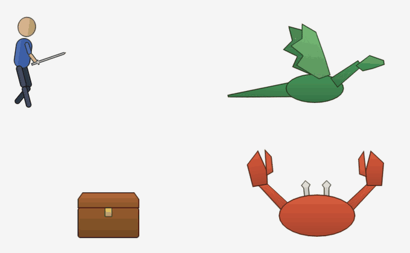

<h1 align="center">rydspine</h1>

<p align="center">
  <b>Rig and animate Spine 4.3 skeletons by asking your AI.</b><br>
  An MCP server that turns PSDs, PNG parts or a flat picture into bones, meshes, constraints and animations,<br>
  and checks every edit with the official Spine runtime.
</p>

<p align="center">
  <a href="https://github.com/ryderdinh/rydspine-mcp/actions/workflows/test.yml"></a>
  <a href="LICENSE"></a>
  
  
  <a href="https://modelcontextprotocol.io"></a>
</p>

<p align="center">
  <a href="https://ryderdinh.github.io/rydspine-mcp/"><b>Install</b></a> ·
  <a href="TOOLS.md">Tool reference</a> ·
  <a href="#quick-start">Quick start</a> ·
  <a href="CONTRIBUTING.md">Contributing</a> ·
  <a href="CHANGELOG.md">Changelog</a>
</p>

<p align="center">
  
  <br><sub>Rigged and animated entirely through rydspine's tools: run, stop and swing with IK legs; wing flap with neck and tail out of phase; lid bounce with a fading glow; a crab built from a PSD with pivot markers, its right half mirrored from the left.</sub>
</p>

## Why rydspine

Rigging a 2D character in Spine takes hours of placing bones, weighting meshes and keying curves. rydspine gives an AI assistant (Claude Code, Claude Desktop, Codex or any MCP client) a set of precise, typed tools for that work, so you can say *"rig this dragon and make it fly"* and get a real Spine project back.

- **The AI reasons, the server executes.** The model reads your art and picks bones and motions; rydspine performs each step as a validated, undoable operation. It never calls a model itself.
- **Checked by the real runtime.** Every edit is loaded and played in the official `spine-core` 4.3 runtime before it is saved, and rejected if it breaks the skeleton.
- **Real Spine output.** Skeleton JSON, atlas and PNG for any Spine 4.3 runtime, plus a self-contained HTML player. Open it in the Spine Editor with *Import Data* and keep working by hand.
- **Not just characters.** Templates and tools for limbs, wings, tails, hinges, wheels, plants, logos and props.

## Features

| | |
|---|---|
| **Input** | Layered PSDs (with `[pivot]` marker layers for joints), separate PNG parts, flat pictures split by polygon, existing Spine 4.3 exports (JSON or binary `.skel`), image sequences |
| **Rigging** | Bones in world coordinates, rig templates (chain, hinge, wheel, IK limb, biped, quadruped), outline-following meshes with automatic weights, IK, transform, path, physics and slider constraints, skins, left/right mirroring, points, hit boxes and clipping masks |
| **Animation** | Motion primitives (oscillate with follow-through, tween with anticipation, bounce, walk and run cycles), hand keys, slot, constraint, event, draw order, sequence and mesh deform keys, CSS-style bezier easing |
| **Checks** | Runtime validation, loop seam checks, folded or stretched mesh detection, foot sliding, frame previews |
| **Editing** | Every change is a version: diff, revert, lock approved parts, re-import edits made in the Spine Editor |
| **Output** | Spine 4.3 JSON, atlas, PNG, an `images/` folder for the Spine Editor, an HTML player, and the rydspine studio web view |

49 tools in all; see the [tool reference](TOOLS.md).

## Quick start

### Installer (macOS, Windows)

Download the installer from the [install page](https://ryderdinh.github.io/rydspine-mcp/) and double-click it. It needs [Node.js 20+](https://nodejs.org), downloads rydspine into `~/.rydspine/app` and connects it to the apps it finds: Claude Code (with the rigging skill), Claude Desktop and Codex. Run it again to update.

### From source

```bash
git clone https://github.com/ryderdinh/rydspine-mcp
cd rydspine-mcp
npm install
npx playwright install chromium   # optional: PNG previews
npm run setup                     # connect Claude Code, Claude Desktop and Codex
```

Opening this folder in Claude Code picks up the bundled `.mcp.json` automatically. Any other MCP client can run the server over stdio (desktop apps may not see your shell's `PATH`; `npm run setup` writes absolute paths for that reason):

```json
{
  "mcpServers": {
    "rydspine": {
      "command": "npx",
      "args": ["tsx", "/path/to/rydspine-mcp/src/index.ts"],
      "env": { "RYDSPINE_WORKSPACES": "/path/to/workspaces" }
    }
  }
}
```

### First request

```text
Create a Spine project from character.psd. Rig it as a biped with IK legs,
make a looping walk and a one-shot wave, check for foot sliding, then export.
```

The assistant imports the layers, places the joints, binds and meshes the parts, adds constraints, keys the animations, looks at the previews and exports `character.json`, `character.atlas`, `character.png` and `character.html`.

## How it works

A typical session goes through these tools; the [tool reference](TOOLS.md) has every parameter.

| Step | Tools |
|---|---|
| 1. Start | `project_create`, or `project_import` for an existing Spine 4.3 export |
| 2. Bring in art | `psd_import`, `image_import`, `sequence_import`; for one flat picture `image_inspect` then `image_split` |
| 3. Bones | `rig_template` for common structures, or `bone_add` / `bone_update` at joints read off the art |
| 4. Bind and bend | `slot_update` (art stays in place), `mesh_generate`, `constraint_add`, `shape_add`, `mirror_bones`, skins |
| 5. Animate | `anim_create`, then `anim_gait`, `anim_oscillate`, `anim_tween`, `anim_bounce`, `anim_set_keys` and the slot, constraint, event, draw order, sequence and deform key tools |
| 6. Check | `validate`, `motion_check`, `preview` |
| 7. Deliver | `export`; `project_sync` brings back edits made in the Spine Editor |

Every edit runs on a copy of the project, is checked by the runtime and only then saved as a new version, so a rejected edit changes nothing. `history_list`, `history_diff` and `history_revert` move through versions; `lock_set` protects parts you have approved.

**Conventions.** World space is y-up, units are pixels, rotations are degrees counter-clockwise. Animation values are offsets from the setup pose; `scalex` and `scaley` are multipliers.

**Rigging skill.** [`.claude/skills/spine-rigging`](.claude/skills/spine-rigging/SKILL.md) teaches agents to rig the way Esoteric's own example projects do: which constraint to use where, typical physics settings, and the rules the Spine Editor is strict about. Claude Code loads it in this repo, and the installer copies it to `~/.claude/skills/`.

**Studio.** `npm run ui` (or the `ui_open` tool) serves the rydspine studio on http://127.0.0.1:5180: every project's animations in the Spine player, with check results, the bone tree, version history and frame strips.

## Verification

rydspine is tested against Spine itself, not only against its own expectations.

| Command | What it checks |
|---|---|
| `npm test` | Unit and end-to-end tests that drive the server through a real MCP client |
| `npm run acceptance` | Builds eight assets (character, dragon, tree, chest, car, logo, lantern, crab) entirely through the tools, then validates, previews and exports them |
| `npm run spine:check` | Round-trips those assets through the real Spine Editor and compares every bone, slot and vertex frame by frame (needs the Spine Editor) |
| `npm run skel:examples` | Converts every binary `.skel` in Esoteric's official examples and plays it against the runtime's own reading |
| `npm run real:art` | Rigs the dragon from Spine's examples from a PSD built like an artist's delivery and compares it with the original pixel by pixel |

## Configuration

| Variable | Default | Purpose |
|---|---|---|
| `RYDSPINE_WORKSPACES` | `./workspaces` (`~/.rydspine/workspaces` when installed) | Where projects and their version history are stored |
| `RYDSPINE_SPINE_VERSION` | `4.3.26` | Spine version written into new skeletons, to match your editor |
| `SPINE_CLI` | — | Path to the Spine Editor executable, for `npm run spine:check` and `npm run real:art` |
| `SPINE_ACTIVATION_CODE` | — | Linux only: lets `spine:check` download and activate the Spine Editor. Read from the environment, never stored or printed |

## Status

rydspine is young (0.1, unreleased) and its tools may still change. Known gaps:

- The Windows installer has not been tried on a Windows machine yet.
- Splitting a flat picture fills hidden areas by spreading edge colors; it does not redraw detail.
- Spine's own `.spine` project format is not written directly; use the Spine Editor's *Import Data* on the exported JSON.

Plans and the development log are in [`dev-notes/`](dev-notes/).

## Contributing

Issues and pull requests are welcome. [CONTRIBUTING.md](CONTRIBUTING.md) covers setup, the code layout and the checks to run; report security problems privately as described in [SECURITY.md](SECURITY.md).

## Acknowledgements

- [Esoteric Software](https://esotericsoftware.com) for Spine and the [Spine Runtimes](https://github.com/EsotericSoftware/spine-runtimes), whose example projects shaped the rigging recipes.
- The community Spine MCP projects listed in [REFERENCES.md](REFERENCES.md), for ideas.
- [ag-psd](https://github.com/Agamnentzar/ag-psd), [Delaunator](https://github.com/mapbox/delaunator) and [constrainautor](https://github.com/kninnug/Constrainautor) for PSD reading and triangulation.

## License

rydspine's own code is released under the [MIT License](LICENSE).

It depends on the [Spine Runtimes](https://github.com/EsotericSoftware/spine-runtimes) (`@esotericsoftware/spine-core`, `@esotericsoftware/spine-player`), which are under the [Spine Runtimes License Agreement](https://esotericsoftware.com/spine-runtimes-license): each user of software that integrates them needs their own [Spine Editor license](https://esotericsoftware.com/spine-purchase). The HTML player that `export` writes bundles `spine-player` together with that license notice. rydspine is an independent project, not affiliated with or endorsed by Esoteric Software; Spine is a trademark of Esoteric Software LLC.

The tests download Esoteric Software's coin sample, whose images may not be used commercially (see its `license.txt`); `npm run real:art` uses art that is for demonstration only. Neither is stored in this repo. The showcase above is drawn in code by `acceptance/build.ts` and rendered with `npm run showcase`.
